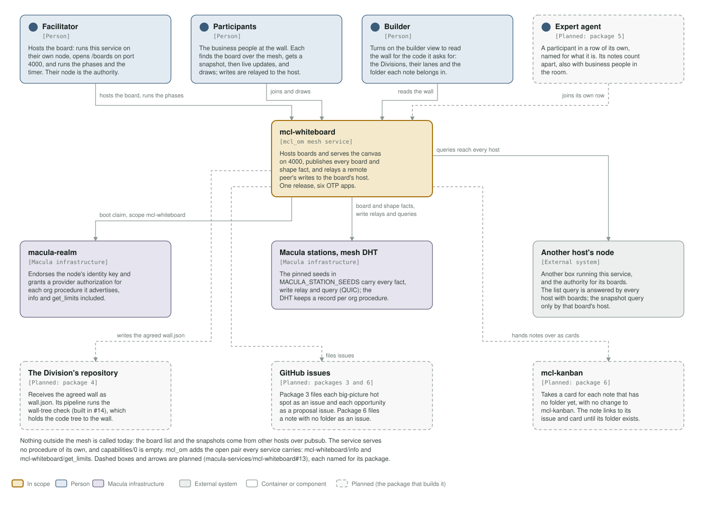
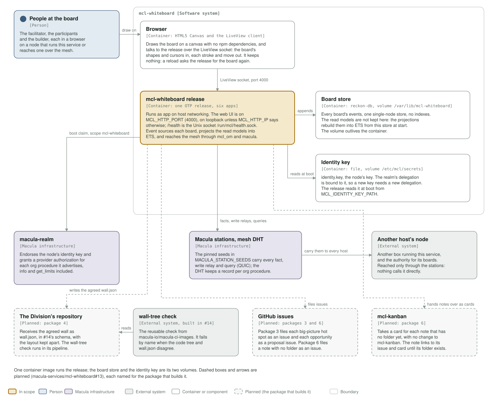
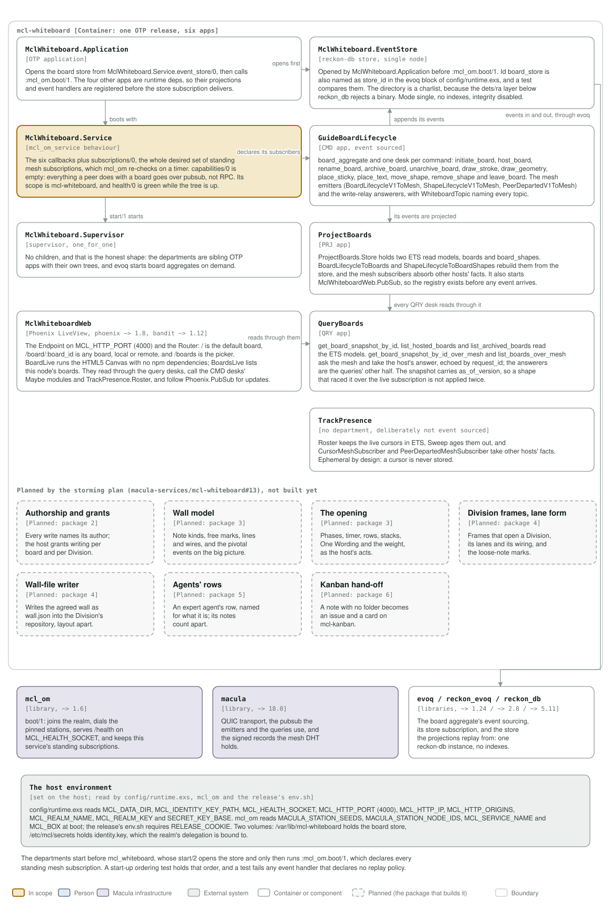

# mcl-whiteboard architecture: C4 model

*This exists so a reader can see what mcl-whiteboard talks to, what it runs as,
and what it is made of, today and in the storming board the plan builds
(macula-services/mcl-whiteboard#13), without reading the code.*

Three diagrams: the Context, the Containers and the Components. A dashed box is
**planned**: the storming plan adds it, and the box names the package that
builds it. Everything drawn solid is built in 0.2.0.

**Status: six apps in one release, no central server.** A host runs the service
on their own node and serves the canvas on 4000. Boards are hosted by the node
that created them, and everything a peer does with a board travels over pubsub.
The service serves no procedure of its own: `capabilities/0` is the list, and it
is empty. `mcl_om` adds `mcl-whiteboard/info` and `mcl-whiteboard/get_limits` to
every service, both open.

## Level 1: system context

| Element | Kind | Role |
| --- | --- | --- |
| mcl-whiteboard | In scope | Hosts boards, serves the canvas on 4000, publishes every board and shape fact, and relays a remote peer's writes to the board's host. One OTP release, six apps, one container |
| Facilitator | Person | Hosts the board: runs the service on their own node, opens `/boards` in a browser on port 4000, and runs the phases and the timer. Their node is the authority for the boards it hosts |
| Participants | Person | The business people at the wall. Each finds the board over the mesh, gets a snapshot, then live updates, and draws on it; the writes are relayed to the host |
| Builder | Person | Turns on the builder view to read the wall for the code it asks for: the Divisions, their lanes, and the folder each note belongs in |
| Expert agent | Planned, package 5 | A participant in a row of its own, named for what it is. Its notes count apart, also with business people in the room |
| macula-realm | Macula infrastructure | Endorses the node's identity key and grants a provider authorization per org procedure, `mcl-whiteboard/info` and `mcl-whiteboard/get_limits` included. The procedures are open to callers, but an advertisement still needs that grant: without it `/health` reads degraded |
| Macula stations, mesh DHT | Macula infrastructure | The pinned seeds in `MACULA_STATION_SEEDS` carry every fact, write relay and query over QUIC; the DHT keeps a record per org procedure |
| Another host's node | External system | Another box running this service, and the authority for its boards. Both queries reach every host: the list query is answered by every host that has boards, and the snapshot query only by that board's host |
| The Division's repository | Planned, package 4 | Receives the agreed wall as `wall.json`, in #14's schema. Its pipeline runs the `wall-tree` check |
| GitHub issues | Planned, packages 3 and 6 | Package 3 files each big-picture hot spot as an issue and each opportunity as a `proposal` issue. Package 6 files a note with no folder as an issue |
| mcl-kanban | Planned, package 6 | Takes a card for each note that has no folder yet, with no change to mcl-kanban |

Nothing outside the mesh is called today: the board list and the snapshots come
from other hosts over pubsub.

## Level 2: containers

| Container | Technology | Responsibility |
| --- | --- | --- |
| Browser | HTML5 Canvas and the LiveView client | Draws the board with no npm dependencies and talks to the release over the LiveView socket. It keeps nothing: a reload asks the release for the board again |
| mcl-whiteboard release | one OTP release, six apps, in one container image | Runs as `app` on host networking. The web UI is on `MCL_HTTP_PORT` (4000), on loopback unless `MCL_HTTP_IP` says otherwise; `/health` is the Unix socket `/run/mcl/health.sock`. It event sources each board, projects the read models into ETS, and reaches the mesh through `mcl_om` and macula |
| Board store | reckon-db, on the volume `/var/lib/mcl-whiteboard` | Every board's events. The read models are not kept here: the projections rebuild them into ETS from this store at start |
| Identity key | a file, on the volume `/etc/mcl/secrets` | `identity.key`, the node's key, read at boot from `MCL_IDENTITY_KEY_PATH`. The realm's delegation is bound to it |

Outside the boundary are the realm, the stations and another host's node, as in
the Context, and the planned systems. The `wall-tree` check is built (#14): it
is the reusable check in macula-io/macula-ci-images, and it runs in the
Division's pipeline, not here.

## Level 3: components

| Component | Technology | Responsibility |
| --- | --- | --- |
| `MclWhiteboard.Application` | OTP application | Opens the board store from `MclWhiteboard.Service.event_store/0`, then calls `:mcl_om.boot/1`. The four other apps are runtime deps, so their projections and event handlers are registered before the store subscription delivers |
| `MclWhiteboard.Service` | the `mcl_om_service` behaviour | The six callbacks plus `subscriptions/0`, the whole desired set of standing mesh subscriptions, which `mcl_om` re-checks on a timer. `capabilities/0` is empty: everything a peer does with a board goes over pubsub, not RPC |
| `MclWhiteboard.Supervisor` | supervisor, `one_for_one` | No children, and that is the honest shape: the departments are sibling OTP apps with their own trees, and evoq starts board aggregates on demand |
| `MclWhiteboardWeb` | Phoenix LiveView, `phoenix ~> 1.8`, `bandit ~> 1.12` | The Endpoint on `MCL_HTTP_PORT` (4000) and the Router: `/`, `/board/:board_id` and `/boards`. `BoardLive` runs the HTML5 Canvas with no npm dependencies. The LiveViews read through the query desks, call the CMD desks' `Maybe` modules (dispatch locally, relay remotely) and `TrackPresence.Roster`, and follow live updates over `Phoenix.PubSub` |
| `MclWhiteboard.EventStore` | reckon-db store, single node | Id `board_store`, also named as `store_id` in the evoq block of `config/runtime.exs`, and a test compares them. The directory is a charlist, because the dets/ra layer under `reckon_db` rejects a binary |
| `GuideBoardLifecycle` | CMD app, event sourced | `board_aggregate` and one desk per command: initiate, host, rename, archive, unarchive, draw a stroke, draw geometry, place a sticky, place text, move, remove, leave. The mesh emitters, the write-relay answerers, and `WhiteboardTopic` |
| `ProjectBoards` | PRJ app | `ProjectBoards.Store` holds two ETS read models, `boards` and `board_shapes`; the two projections rebuild them from the store and the mesh subscribers absorb other hosts' facts. It also starts `MclWhiteboardWeb.PubSub` |
| `QueryBoards` | QRY app | `get_board_snapshot_by_id`, `list_hosted_boards`, `list_archived_boards`, and the mesh queries with their answerers. The snapshot carries `as_of_version`, so a shape that raced it is not applied twice |
| `TrackPresence` | no department, deliberately not event sourced | `Roster` keeps the live cursors in ETS, `Sweep` ages them out, and the two subscribers take other hosts' facts. A cursor is never stored |
| `mcl_om` | library, `~> 1.6` | `boot/1`: joins the realm, dials the pinned stations, serves `/health` on the Unix socket `MCL_HEALTH_SOCKET`, and keeps this service's standing subscriptions |
| macula | library, `~> 18.0` | QUIC transport, the pubsub the emitters and the queries use (every subscription names its sources: the nodes the realm delegated this service's org), and the signed records the mesh DHT holds |
| `evoq` / `reckon_evoq` / `reckon_db` | libraries, `~> 1.24` / `~> 2.8` / `~> 5.11` | The board aggregate's event sourcing, its store subscription, and the store the projections replay from |
| The host environment | `config/runtime.exs`, `mcl_om` and the release's `env.sh`; two volumes | `config/runtime.exs` reads `MCL_DATA_DIR`, `MCL_IDENTITY_KEY_PATH`, `MCL_HEALTH_SOCKET` (`/run/mcl/health.sock`), `MCL_HTTP_PORT` (4000), `MCL_HTTP_IP` (127.0.0.1), `MCL_HTTP_ORIGINS`, `MCL_REALM_NAME`, `MCL_REALM_KEY` and `SECRET_KEY_BASE`. `mcl_om` reads `MACULA_STATION_SEEDS`, `MACULA_STATION_NODE_IDS`, `MCL_SERVICE_NAME` and `MCL_BOX` at boot, and the release's `env.sh` requires `RELEASE_COOKIE`. `/var/lib/mcl-whiteboard` holds the board store, `/etc/mcl/secrets` holds `identity.key`, which the realm's delegation is bound to |

The departments start before `mcl_whiteboard`, whose `start/2` opens the store and
only then runs `:mcl_om.boot/1`, which declares every standing mesh subscription.
A start-up ordering test holds that order, and a test fails any event handler that
declares no replay policy: the mesh emitters skip a restart's replay, the
projections deliver it because that is how they are rebuilt.

The dashed boxes below the built ones are the components the storming plan
adds. Each names the package that builds it, and when that package lands the box
becomes a built one in the same commit.

## Planned boxes

Every dashed box, the diagram it is in, and the package that builds it.
`architecture/test_c4_planned_boxes.py` reads this table: it fails, naming the
box, when a listed box is drawn as anything but planned, and when a planned box
is drawn that this table does not list.

| Box | Diagram | Package |
| --- | --- | --- |
| Expert agent | c4-context.svg | 5 |
| The Division's repository | c4-context.svg | 4 |
| GitHub issues | c4-context.svg | 3 and 6 |
| mcl-kanban | c4-context.svg | 6 |
| The Division's repository | c4-container.svg | 4 |
| GitHub issues | c4-container.svg | 3 and 6 |
| mcl-kanban | c4-container.svg | 6 |
| Authorship and grants | c4-components.svg | 2 |
| Wall model | c4-components.svg | 3 |
| The opening | c4-components.svg | 3 |
| Division frames, lane form | c4-components.svg | 4 |
| Wall-file writer | c4-components.svg | 4 |
| Agents' rows | c4-components.svg | 5 |
| Kanban hand-off | c4-components.svg | 6 |

Out of scope for every package: pricing, and any change to mcl-kanban.

## Drawing them

`assets/c4-context.svg`, `assets/c4-container.svg` and `assets/c4-components.svg` are generated by
`architecture/c4_diagrams.py` (`python3 architecture/c4_diagrams.py`), from the
code and never from this page: the callbacks and `subscriptions/0` in
`apps/mcl_whiteboard/lib/mcl_whiteboard/service.ex`, the desks of each department,
the router and LiveViews in `apps/mcl_whiteboard_web`, the dependencies in the
apps' `mix.exs` files, and the ports and volumes in the `Containerfile` and
`deploy/docker-compose.yml`. When one of those changes, the diagram changes in the
same commit.

Two rules for the files themselves, so they render everywhere they are read
(GitHub, an IDE, `rsvg-convert`): self-contained SVG, and literal colours in plain
classes plus a `prefers-color-scheme` dark block, never CSS custom properties,
which `rsvg-convert` renders black.

The checks that keep them here are in `.github/workflows/c4-model.yml`, which
runs on every pull request and every push to main, with no path filter:

- `c4-model`, the shared gate: red until the Context, Container and Component
  diagrams exist and are shown, and red if one goes missing.
- `c4-drift`: runs the generator and fails, naming the files, when a committed
  SVG differs from what it draws today. A change to the diagram and to the
  generator goes in the same commit. It then runs
  `architecture/test_c4_planned_boxes.py`.

`.github/workflows/c4-design-gate.yml` answers the owner's `gate:design` label on
a plan issue: it fails a check, by name, while the Context or the Container
diagram is missing.

**Where the station list comes from.** It is not in `config/runtime.exs`: `mcl_om` reads `MACULA_STATION_SEEDS` and `MACULA_STATION_NODE_IDS` from the environment at boot, paired index for index, so this repository pins no station and the list may be any length.
