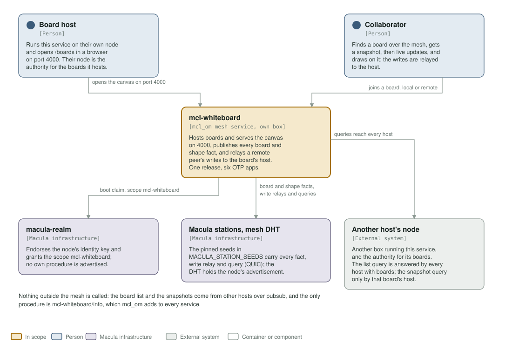
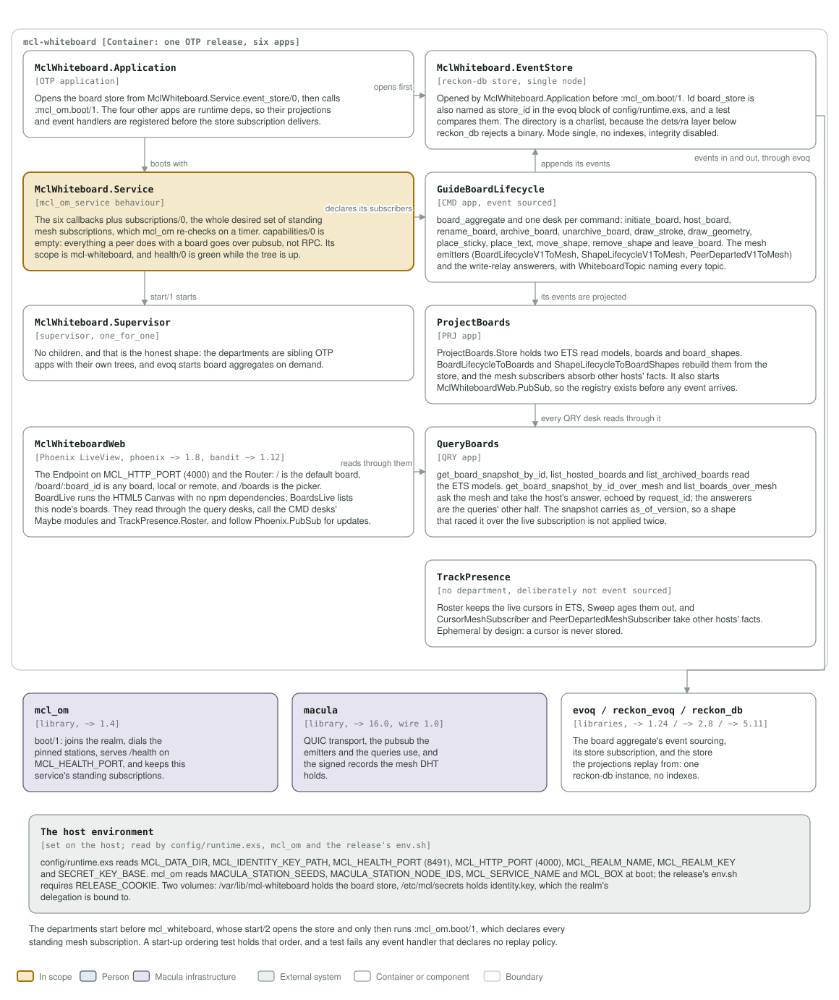

# mcl-whiteboard architecture: C4 model

*This exists so a reader can see what mcl-whiteboard talks to, and what it is
made of, without reading it.*

**Status: six apps in one release, no central server.** A host runs the service
on their own node and serves the canvas on 4000. Boards are hosted by the node
that created them, and everything a peer does with a board travels over pubsub.
The service serves no procedure of its own: `capabilities/0` is the list, and it
is empty. `mcl_om` adds `mcl-whiteboard/info` and `mcl-whiteboard/get_limits` to
every service, both open.

## Level 1: system context

| Element | Kind | Role |
| --- | --- | --- |
| mcl-whiteboard | In scope | Hosts boards, serves the canvas on 4000, publishes every board and shape fact, and relays a remote peer's writes to the board's host. One OTP release, six apps, one container |
| Board host | Person | Runs the service on their own node and opens `/boards` in a browser on port 4000. Their node is the authority for the boards it hosts |
| Collaborator | Person | Finds a board over the mesh, gets a snapshot, then live updates, and draws on it; the writes are relayed to the host |
| macula-realm | Macula infrastructure | Endorses the node's identity key and grants a a provider authorization per org procedure, `mcl-whiteboard/info` and `mcl-whiteboard/get_limits` included. The procedures are open to callers, but an advertisement still needs that grant: without it `/health` reads degraded |
| Macula stations, mesh DHT | Macula infrastructure | The pinned seeds in `MACULA_STATION_SEEDS` carry every fact, write relay and query over QUIC; the DHT holds the node's advertisement |
| Another host's node | External system | Another box running this service, and the authority for its boards. Both queries reach every host: the list query is answered by every host that has boards, and the snapshot query only by that board's host |

Nothing outside the mesh is called: the board list and the snapshots come from
other hosts over pubsub.

## Level 2: containers and components

| Component | Technology | Responsibility |
| --- | --- | --- |
| `MclWhiteboard.Application` | OTP application | Opens the board store from `MclWhiteboard.Service.event_store/0`, then calls `:mcl_om.boot/1`. The four other apps are runtime deps, so their projections and event handlers are registered before the store subscription delivers |
| `MclWhiteboard.Service` | the `mcl_om_service` behaviour | The six callbacks plus `subscriptions/0`, the whole desired set of standing mesh subscriptions, which `mcl_om` re-checks on a timer. `capabilities/0` is empty: everything a peer does with a board goes over pubsub, not RPC |
| `MclWhiteboard.Supervisor` | supervisor, `one_for_one` | No children, and that is the honest shape: the departments are sibling OTP apps with their own trees, and evoq starts board aggregates on demand |
| `MclWhiteboardWeb` | Phoenix LiveView, `phoenix ~> 1.8`, `bandit ~> 1.12` | The Endpoint on `MCL_HTTP_PORT` (4000) and the Router: `/`, `/board/:board_id` and `/boards`. `BoardLive` runs the HTML5 Canvas with no npm dependencies. The LiveViews read through the query desks, call the CMD desks' `Maybe` modules (dispatch locally, relay remotely) and `TrackPresence.Roster`, and follow live updates over `Phoenix.PubSub` |
| `MclWhiteboard.EventStore` | reckon-db store, single node | Id `board_store`, also named as `store_id` in the evoq block of `config/runtime.exs`, and a test compares them. The directory is a charlist, because the dets/ra layer under `reckon_db` rejects a binary |
| `GuideBoardLifecycle` | CMD app, event sourced | `board_aggregate` and one desk per command: initiate, host, rename, archive, unarchive, draw a stroke, draw geometry, place a sticky, place text, move, remove, leave. The mesh emitters, the write-relay answerers, and `WhiteboardTopic` |
| `ProjectBoards` | PRJ app | `ProjectBoards.Store` holds two ETS read models, `boards` and `board_shapes`; the two projections rebuild them from the store and the mesh subscribers absorb other hosts' facts. It also starts `MclWhiteboardWeb.PubSub` |
| `QueryBoards` | QRY app | `get_board_snapshot_by_id`, `list_hosted_boards`, `list_archived_boards`, and the mesh queries with their answerers. The snapshot carries `as_of_version`, so a shape that raced it is not applied twice |
| `TrackPresence` | no department, deliberately not event sourced | `Roster` keeps the live cursors in ETS, `Sweep` ages them out, and the two subscribers take other hosts' facts. A cursor is never stored |
| `mcl_om` | library, `~> 1.4` | `boot/1`: joins the realm, dials the pinned stations, serves `/health` on `MCL_HEALTH_PORT`, and keeps this service's standing subscriptions |
| macula | library, `~> 16.0`, wire 1.0 | QUIC transport, the pubsub the emitters and the queries use, and the signed records the mesh DHT holds |
| `evoq` / `reckon_evoq` / `reckon_db` | libraries, `~> 1.24` / `~> 2.8` / `~> 5.11` | The board aggregate's event sourcing, its store subscription, and the store the projections replay from |
| The host environment | `config/runtime.exs`, `mcl_om` and the release's `env.sh`; two volumes | `config/runtime.exs` reads `MCL_DATA_DIR`, `MCL_IDENTITY_KEY_PATH`, `MCL_HEALTH_PORT` (8491), `MCL_HTTP_PORT` (4000), `MCL_REALM_NAME`, `MCL_REALM_KEY` and `SECRET_KEY_BASE`. `mcl_om` reads `MACULA_STATION_SEEDS`, `MACULA_STATION_NODE_IDS`, `MCL_SERVICE_NAME` and `MCL_BOX` at boot, and the release's `env.sh` requires `RELEASE_COOKIE`. `/var/lib/mcl-whiteboard` holds the board store, `/etc/mcl/secrets` holds `identity.key`, which the realm's delegation is bound to |

The departments start before `mcl_whiteboard`, whose `start/2` opens the store and
only then runs `:mcl_om.boot/1`, which declares every standing mesh subscription.
A start-up ordering test holds that order, and a test fails any event handler that
declares no replay policy: the mesh emitters skip a restart's replay, the
projections deliver it because that is how they are rebuilt.

## Drawing them

`assets/c4-context.svg` and `assets/c4-components.svg` are generated by
`architecture/c4_diagrams.py` (`python3 architecture/c4_diagrams.py`), from the
code and never from this page: the callbacks and `subscriptions/0` in
`apps/mcl_whiteboard/lib/mcl_whiteboard/service.ex`, the desks of each department,
the router and LiveViews in `apps/mcl_whiteboard_web`, the dependencies in the
apps' `mix.exs` files, and the ports and volumes in the `Containerfile` and
`deploy/docker-compose.yml`. When one of those changes, the diagram changes in the
same commit.

Two rules for the files themselves, so they render everywhere they are read
(GitHub, an IDE, `rsvg-convert`): self-contained SVG, and literal colours in plain
classes plus a `prefers-color-scheme` dark block, never CSS custom properties,
which `rsvg-convert` renders black.

The check that keeps them here is the `c4-model` job in
`.github/workflows/c4-model.yml`. It is red until both files exist and are shown, and it
stays red if either one goes missing.

**Where the station list comes from.** It is not in `config/runtime.exs`: `mcl_om` reads `MACULA_STATION_SEEDS` and `MACULA_STATION_NODE_IDS` from the environment at boot, paired index for index, so this repository pins no station and the list may be any length.
